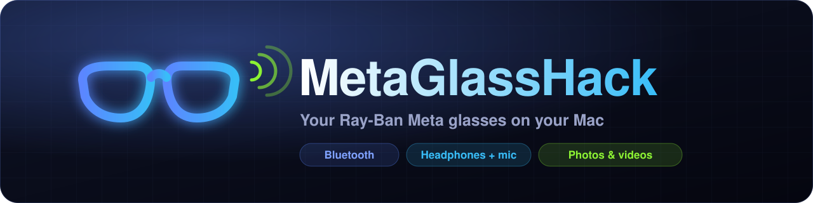
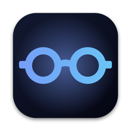

<div align="center">

[](#readme)

[](https://github.com/gabrielxreis/metaglasshack/commits/main "History")
[](#requirements "Requirements")
[](#repository-layout "Layout")
[](#glasses "Glasses")
[](#compatibility "Compatibility")
[](#requirements "Requirements")
[](LICENSE "License")

</div>

**MetaGlassHack** is a native Mac app for **Ray-Ban Meta** glasses owners. It pairs and connects your glasses to your Mac over Bluetooth, turns them into the Mac's **headphones and microphone**, shows **battery, firmware and connection mode**, reads everything the glasses expose over **Bluetooth LE**, and brings the **photos and videos** your glasses captured to your Mac, with thumbnails, selection and a green badge on what's already been copied. All in a dark glass UI, with no account, no cloud and no server.

<div align="center">



| Glasses | Photos & videos | BLE info |
|:---:|:---:|:---:|
| Pair, connect and use as the Mac's headphones and mic | Thumbnails of what your glasses captured, with an **ON MAC** badge | Every service and characteristic the glasses expose, with a log |

</div>

> **Independent project.** MetaGlassHack is not made by, affiliated with or endorsed by Meta or EssilorLuxottica. "Meta" and "Ray-Ban" are trademarks of their respective owners. The app does not break any encryption or touch the firmware: it uses macOS Bluetooth and reads your iPhone's camera roll over a USB cable.

* [WHAT IT DOES](#what-it-does)
* [INSTALLATION](#installation)
    * [Requirements](#requirements)
    * [Build and run](#build-and-run)
* [FIRST USE](#first-use)
    * [Pair the glasses with your Mac](#pair-the-glasses-with-your-mac)
    * [Bring photos and videos over](#bring-photos-and-videos-over)
* [SCREENS](#screens)
    * [Glasses](#glasses)
    * [Photos and videos](#photos-and-videos)
    * [BLE info](#ble-info)
    * [Settings](#settings)
* [HOW IT WORKS](#how-it-works)
* [WHAT'S NOT POSSIBLE (YET)](#whats-not-possible-yet)
* [COMPATIBILITY](#compatibility)
* [TROUBLESHOOTING](#troubleshooting)
* [REPOSITORY LAYOUT](#repository-layout)
* [RESEARCH AND REFERENCES](#research-and-references)
* [LICENSE](#license)


# WHAT IT DOES

- **Pairs the glasses with your Mac.** With the blue light blinking, the app finds the glasses and pairs them in one click. Once paired, the pairing screens go away, leaving only a small button to pair another device.
- **Mac headphones and microphone.** Connects and disconnects the glasses, picks the macOS output and input devices, and has a **"Headphones only (better sound)"** shortcut that keeps the mic on the Mac so music doesn't drop to call quality.
- **Live status.** Battery, firmware and mode (Headphones + mic, Headphones, Call) read straight from macOS, in a card pinned to the sidebar.
- **Your glasses' photos and videos on the Mac.** Reads the iPhone's camera roll **over the cable in under a second**, keeps only what the glasses captured (using the camera metadata) and shows the thumbnails **before** copying. Select, send to the Mac, and everything already copied gets an **ON MAC** badge. Files go to `~/Pictures/Oculos Meta/YYYY-MM-DD/`.
- **Automatic, if you want.** With the iPhone plugged in, the app checks periodically and can copy anything new on its own.
- **Bluetooth LE x-ray.** Scans for the glasses, connects, and reads every service and characteristic (firmware, manufacturer and Meta's own fields), listens to notifications and saves a Markdown report for research.


# INSTALLATION

## Requirements

| What | Why |
|---|---|
| **macOS 14 (Sonoma) or newer**, Apple Silicon | Native SwiftUI app |
| **Xcode** or the Command Line Tools (`xcode-select --install`) | Builds the app with `swiftc` |
| **Python 3.10+** | Runs the iPhone reader ([`pymobiledevice3`](https://github.com/doronz88/pymobiledevice3)), installed automatically on the first build |
| **Ray-Ban Meta glasses** and the **Meta AI** app on an iPhone | The glasses send what they capture to Meta AI, which saves it to the camera roll |
| A **cable** between iPhone and Mac | To bring photos and videos over without iCloud |

## Build and run

```bash
git clone https://github.com/gabrielxreis/metaglasshack.git
```

```bash
cd metaglasshack && ./build.sh && open "build/Wayfarer Mac.app"
```

On the first run, `build.sh` sets up the iPhone reader environment (`tools/venv`), then builds the app, generates the icon and signs it. If there's a development certificate in your Keychain it signs with it (so macOS keeps the Bluetooth and Photos permissions between builds); otherwise it signs ad hoc.

On first launch macOS asks for **Bluetooth** access (to find and read the glasses) and, if you use the "Mac Photos" source, **Photos** access.


# FIRST USE

## Pair the glasses with your Mac

1. Put the glasses in **pairing mode**:
   - **In the open case:** hold the button on the back of the case for 5 to 8 seconds until the light blinks blue.
   - **Out of the case:** with the arms folded, hold the capture button (on top of the right arm) for about 12 seconds until the inner light blinks blue.
2. In the app, on the **Glasses** tab, click **Search to pair**, then **Pair** on the glasses (they show up as `RB Meta ...`).
3. Done: the glasses are now the Mac's headphones and mic. If they won't connect, they're probably held by the iPhone: turn off the phone's Bluetooth and click **Connect**.

## Bring photos and videos over

1. In the **Meta AI** app on the iPhone, turn on **Auto import**: whatever the glasses capture goes to the camera roll.
2. Plug the iPhone into the Mac **with a cable**, unlock it and tap **Trust** if asked.
3. Open the **Photos and videos** tab: within a second you'll see thumbnails of what came from the glasses.
4. Click to select, then use **Send selected** (or **Send all new**).


# SCREENS

> The app's interface is currently in Brazilian Portuguese. The labels below are translated.

## Glasses

Main card with the glasses' name, the **ON MAC** badge when connected, **battery**, **firmware** and **mode**. Next to it, the list of paired devices with connect/disconnect and the **Mac audio** card with the system output and input. The pairing screen only shows up when there are no glasses paired (or when you ask to pair another device).

## Photos and videos

Two sources:

| Source | How it works | Speed |
|---|---|---|
| **From iPhone (cable)** (default) | Reads the iPhone's camera roll over the cable and checks each file's header | under 1 s |
| **Mac Photos** | Uses the Photos library (iCloud) and checks the metadata | depends on iCloud |

At the top there's just a **progress bar** with how many glasses files were found. Below it, the **gallery**: All / New / On Mac filters, click to select, double-click opens what's already been copied, right-click for more options. Videos show their duration.

## BLE info

Scans for BLE devices (with a **Glasses only** filter), connects and lists every service and characteristic with its properties (read, write, notify). Standard fields are decoded (firmware, manufacturer, battery) and the rest are shown as hex and text. **Save report** writes a `.md` with everything plus the log.

## Settings

The gear in the top corner of the **Photos and videos** tab opens:
- **Folder on the Mac** (default `~/Pictures/Oculos Meta`, with one subfolder per day).
- **Search:** how many days to look back, send automatically when something new arrives, accept 3:4 vertical videos without metadata, re-check everything.
- **Import from a folder:** for files that arrived via AirDrop, memory card or Downloads (copy or move).


# HOW IT WORKS

```
 Ray-Ban Meta glasses
   │  Classic Bluetooth (HFP/A2DP) ───────────────► Mac: headphones and mic (IOBluetooth + CoreAudio)
   │  Bluetooth LE (180A + Meta's FD5F service) ──► Mac: info and x-ray (CoreBluetooth)
   │
   │  Encrypted Wi-Fi Direct
   ▼
 Meta AI app (iPhone) ──► camera roll ──cable (AFC)──► Mac: thumbnails and copy (pymobiledevice3)
```

- **Which files came from the glasses:** glasses files carry `Make = Meta AI` and `Model = Ray-Ban Meta Smart Glasses 2` in their metadata. The reader only checks the start (and, for videos, the end) of each file, without downloading the rest.
- **Battery and firmware:** read from `system_profiler SPBluetoothDataType`, refreshed every 20 seconds.
- **Connection status:** checked on a fresh `IOBluetoothDevice` object and against the active CoreAudio devices (the object from `pairedDevices()` keeps a stale status).


# WHAT'S NOT POSSIBLE (YET)

- **Reading the glasses' storage directly, without the phone.** Photos and videos leave the glasses over an **encrypted** Wi-Fi Direct link, using a key that Meta's servers only hand to the Meta AI app during pairing. Over Bluetooth LE the glasses only expose device info and control fields. The path that works is the one the app uses: glasses → Meta AI → camera roll → cable → Mac.
- **Reading the Meta AI app's internal folder.** The app doesn't enable file sharing. A local backup can reach it, but the iPhone streams the whole device over the cable (tens of minutes) and the folder holds almost nothing: Meta AI deletes the original after saving it to the camera roll.
- **Live camera on the Mac.** Meta only opens the glasses' camera to phone apps, through the [official SDK](https://github.com/facebook/meta-wearables-dat-ios). It works with a relay iPhone app, but requires **Developer Mode** on both the iPhone and Meta AI. Left out of this version.
- **Managing the apps connected to the glasses** (Spotify, WhatsApp, Instagram...): only through Meta AI, there's no public API.
- **Old photos that only live in iCloud.** With "Optimize Storage" on, older originals aren't on the iPhone and don't show up over the cable. For those, use the **Mac Photos** source.


# COMPATIBILITY

| Glasses | Bluetooth / audio | BLE info | Photos and videos |
|---|:---:|:---:|:---:|
| Ray-Ban Meta (Gen 2) | ✅ tested | ✅ tested | ✅ tested (via iPhone) |
| Ray-Ban Meta (Gen 1) | should work | should work | should work (via iPhone) |
| Oakley Meta | should work | should work | should work (via iPhone) |
| Ray-Ban Stories (2021) | should work | should work | different metadata, may not be recognized |

Tested on macOS 27 with an iPhone on iOS 27.


# TROUBLESHOOTING

- **Connection error code when connecting:** the glasses are held by the iPhone. Turn off the phone's Bluetooth for a minute and connect again.
- **Music sounds like a phone call:** with the glasses' mic active, macOS switches to the call profile. Use **Headphones only (better sound)**.
- **"No iPhone on the cable":** unlock the iPhone and tap **Trust This Computer**.
- **macOS asks for permissions again after rebuilding:** without a development certificate in the Keychain, every build has a new signature. `build.sh` uses a certificate when one is available.
- **Slow search in Mac Photos:** that source has to download the original from iCloud to check its metadata. The app instantly skips what can't be from the glasses (Live Photos, screenshots, panoramas, anything that isn't 3:4) and gives each item at most 12 seconds. Prefer the **From iPhone (cable)** source.


# REPOSITORY LAYOUT

```
metaglasshack/
├── Sources/
│   ├── App.swift            # UI (SwiftUI), design system and the three screens
│   ├── BLEScanner.swift     # Bluetooth LE: scan, connect, read services, report
│   ├── Connections.swift    # Classic Bluetooth, pairing, audio (CoreAudio), battery and firmware
│   └── MediaImporter.swift  # photos and videos: iPhone over cable, Mac Photos, folder, gallery
├── tools/
│   ├── rolo_iphone.py       # iPhone camera roll reader over the cable (AFC)
│   ├── requirements.txt     # pymobiledevice3
│   └── make_icon.swift      # generates the app icon
├── build.sh                 # builds, generates the icon and signs the .app into build/
└── .github/                 # banner and icon for this README
```


# RESEARCH AND REFERENCES

- [**facebook/meta-wearables-dat-ios**](https://github.com/facebook/meta-wearables-dat-ios): Meta's official SDK (glasses camera and audio in iPhone apps).
- [**KonradIT/storiesclient**](https://github.com/KonradIT/storiesclient): independent client for the Ray-Ban Stories (2021), with a map of the BLE + Wi-Fi Direct protocol.
- [**doronz88/pymobiledevice3**](https://github.com/doronz88/pymobiledevice3): iPhone access over the cable, used to read the camera roll.


# LICENSE

[MIT](LICENSE). Use, modify and share freely, keeping the license notice.
